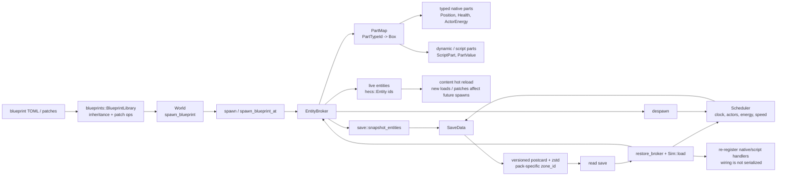

# Entity broker and persistence

Blueprint loading produces resolved part data; spawning stamps those parts into the dynamic broker. Saves contain state and scheduler state, while wiring is rebuilt on restore.

**Legend:** `PartMap` is the dynamic per-entity store alongside the native `hecs` world; there is no generic `StatusStore` or invented ECS facade. Save/restore preserves entity ids, parts, RNG, and scheduler clock/actors, while `Zone` is supplied by the same pack and validated by `zone_id`.
