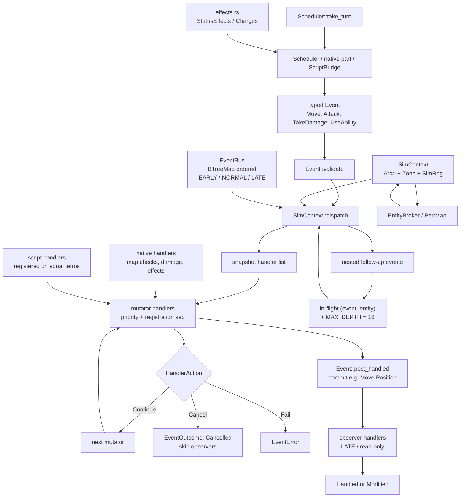

# Typed event bus

Events are plain typed structs. Native handlers and script handlers enter the same dispatch path through the shared broker and `SimContext`.

**Legend:** lower priority values run first; registration sequence breaks ties deterministically. Mutators may modify payloads or cancel; observers run after the mutator phase and cannot cancel. Re-entrant pairs and excessive nesting return errors rather than panicking.
