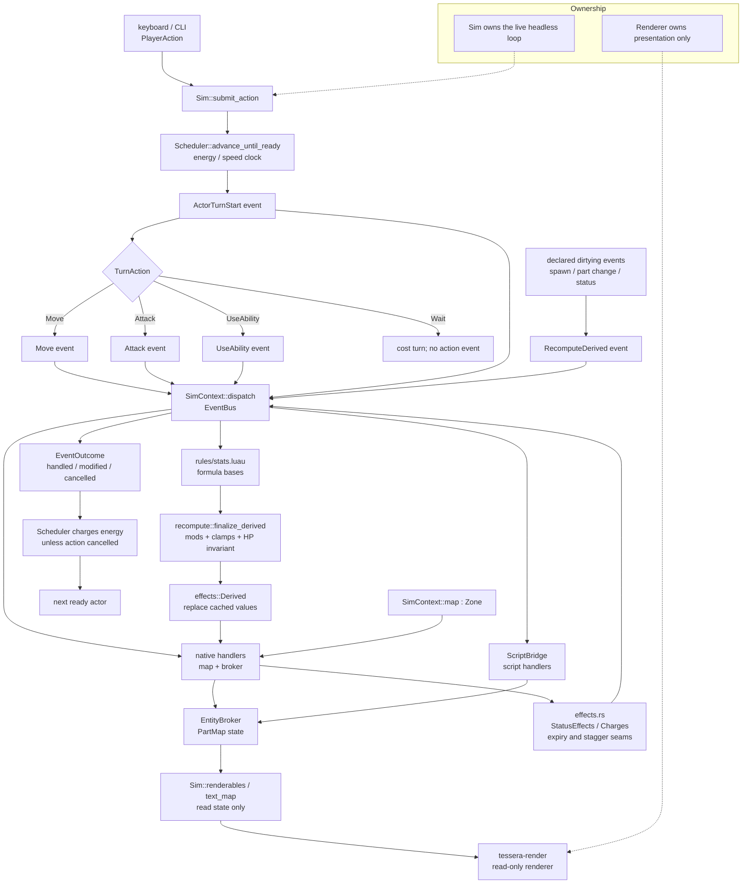

# Runtime turn loop

`Sim::submit_action` drives the energy scheduler until an actor is ready, then `Scheduler::take_turn` dispatches through the shared `SimContext`.

**Legend:** `Move`, `Attack`, `UseAbility`, `RecomputeDerived`, and `ActorTurnStart` are typed events. `rules/stats.luau` owns formula/tuning policy; `recompute::finalize_derived` owns native status modifiers, clamps, and the HP invariant. The renderer is downstream of state reads; it never dispatches events or mutates the broker. Effects are native parts and event handlers in `effects.rs`, not a separate `StatusStore` type. Native hot-loop reads use the cache and do not call scripts.
