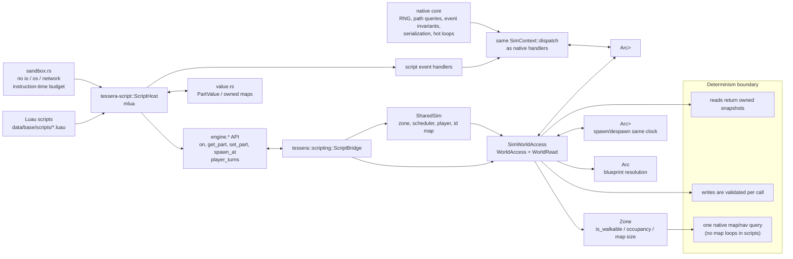

# Script bridge and determinism boundary

The bridge gives Luau owned values and narrow calls, not Rust borrows. Script mutations and native handlers operate on one shared broker and scheduler.

**Legend:** the sandbox limits capabilities, while native core owns deterministic primitives and invariants. Scripts choose policy and tuning; they do not receive `&mut World`, broker guards, or unrestricted iteration. Script-facing ids from `spawn_at` are translated by `SharedSim` to live `hecs::Entity` ids.
