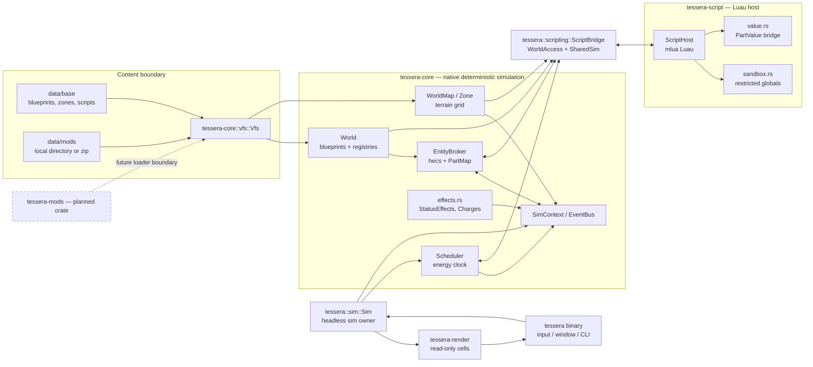

# System boundaries

The binary assembles the headless simulation and the read-only renderer. Content is loaded through `Vfs`; base content uses the same format intended for mods.

**Legend:** solid arrows are current data/control paths. `EntityBroker`, `Scheduler`, and `EventBus` are owned by the headless `Sim`; `tessera-render` reads snapshots/cells and does not own simulation state. `tessera-mods` is planned as a separate crate; the current mod loading path is in the existing core/binary code.
