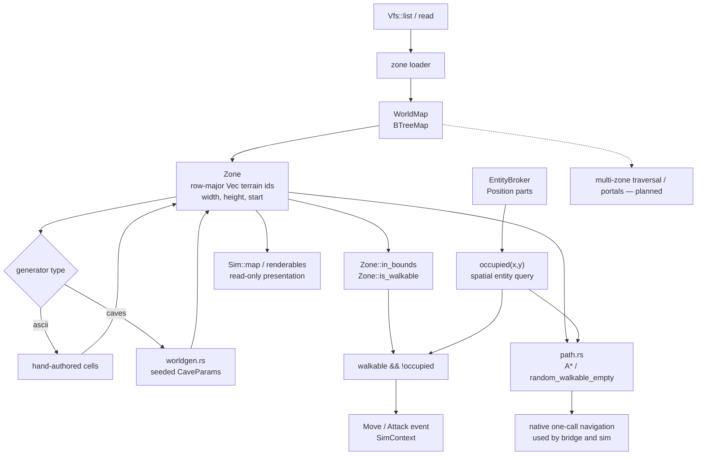

# World, zones, generation, and spatial queries

The current world is a deterministic map of data-loaded zones. A `Zone` owns terrain; entity occupancy is queried from `EntityBroker` positions; pathfinding composes both.

**Legend:** terrain is separate from occupancy: a cell can be walkable yet occupied by an entity. `WorldMap` already supports multiple named zones, while the demo simulates one zone. The dashed portal/traversal node is explicitly planned rather than a current connection.
